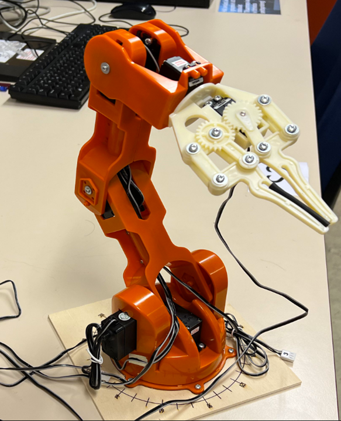
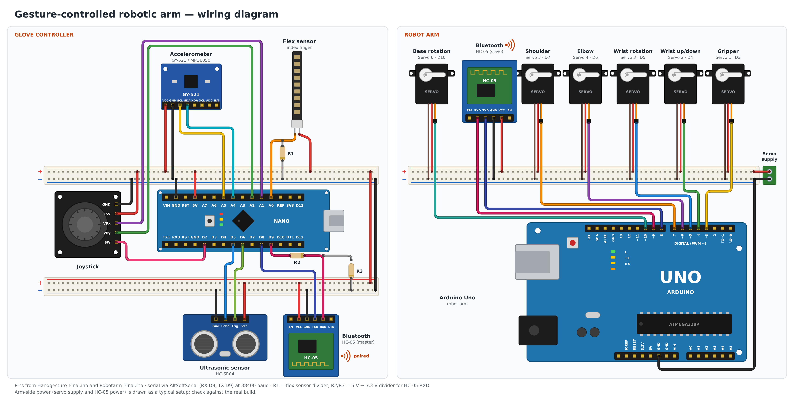
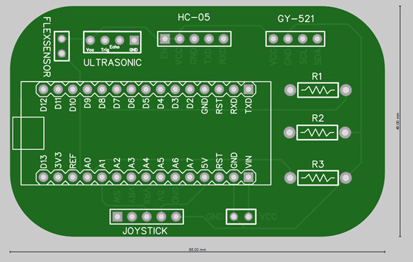
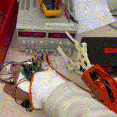
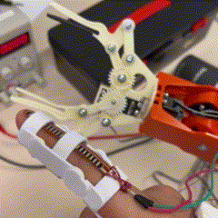
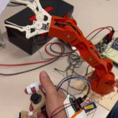
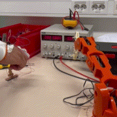

# Gesture-controlled-robotic-arm

A 6-axis robotic arm controlled wirelessly by hand movements, using a sensor glove and two Arduinos communicating over Bluetooth.

## Description
The project consists of two parts: a **glove controller** and a **robotic arm**. The glove reads the hand's movements with several sensors, maps each reading to a servo position and sends all values as one comma-separated string over Bluetooth (HC-05). The Arduino on the arm parses the string and drives six servos, so the arm follows the hand in real time.

Each sensor controls one part of the arm:

* **Flex sensor** (index finger) – opens and closes the gripper
* **Accelerometer** (hand tilt) – moves the wrist up/down and rotates it
* **Ultrasonic sensor** (hand distance) – moves the elbow
* **Joystick** – moves the shoulder and spins the base

A custom PCB was designed for the glove so all sensors connect neatly to the Arduino Nano.

The components used for this build are: 

* Arduino Nano (glove) and Arduino Uno (robot arm)
* 2x HC-05 Bluetooth modules
* GY-521 (MPU6050) accelerometer/gyroscope
* Flex sensor
* HC-SR04 ultrasonic sensor
* Analog joystick module
* 6x servo motors
* 3D-printed robotic arm and gripper
* Custom glove PCB

The schematic of the build:

The PCB designed for the glove:

